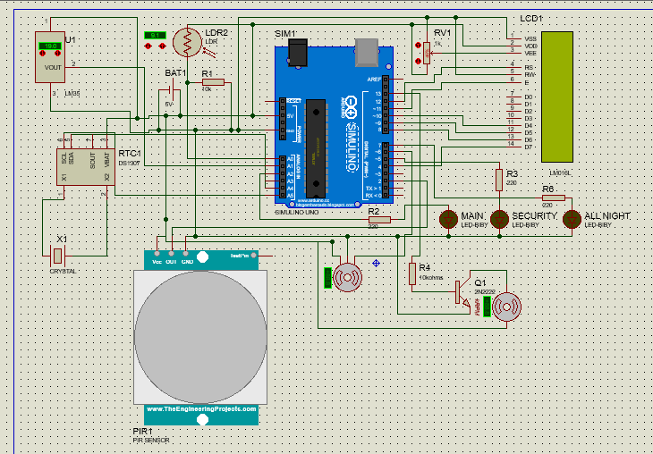
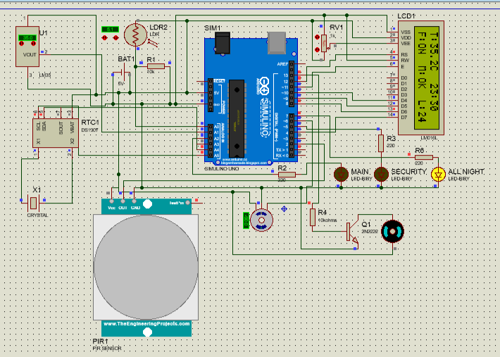
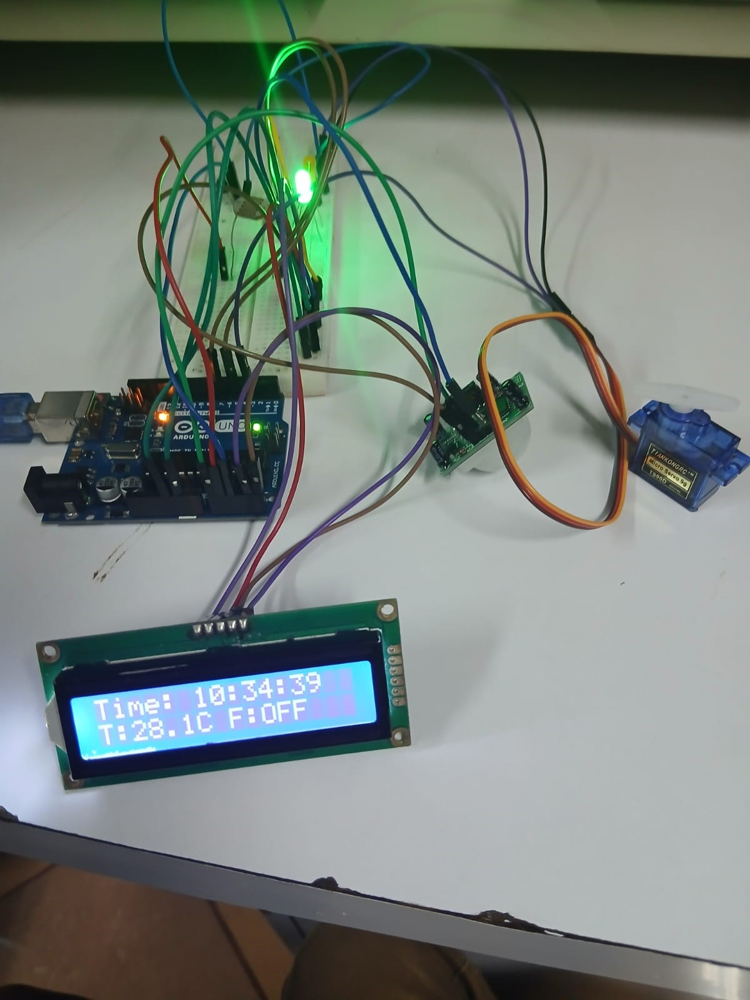

# Arduino Smart Home Automation System

An Arduino Uno–based controller that automates lighting, curtain/gate state, security lighting and cooling using sensor readings and a clock. The project was developed in two stages: first designed and simulated in **Proteus**, then adapted into a **bench prototype** with real sensors.

## About this project

Developed during the School of Engineering internal attachment (April to May 2026) as a team project of 8 members. I developed, debugged and tested the Arduino control code and ran the Proteus simulation, with support from two teammates.

The code was developed iteratively with AI assistance (Google Gemini): I wrote the prompts, tested each version in simulation and on the bench, and made the corrections needed to get it working.

## Repository structure

```
proteus_simulation/   Arduino code + schematic for the Proteus simulation
hardware_build/       Arduino code + photo for the bench prototype
images/               Photos and screenshots used in this README
```

---

## Stage 1: Proteus simulation





### Features

| # | Feature | Logic |
|---|---------|-------|
| 1 | Data acquisition | Reads light (LDR), temperature (LM35) and motion (PIR) every second |
| 2 | Automatic main lights | ON from 18:30 to 21:00 using a DS1307 real-time clock |
| 3 | Curtain control | Servo opens (90°) from 08:00 to 18:00 and closes (0°) otherwise |
| 4 | Security light | ON when it is dark (LDR < 300) **and** motion is detected |
| 5 | Climate control | Fan ON when temperature exceeds 28 °C |
| 6 | Night LED | ON whenever it is dark (LDR < 300), OFF in daylight |
| 7 | Status display | 16x2 LCD shows temperature, time, fan state, motion and light level |

### Components

Arduino Uno, LM35, LDR with 10 kΩ divider, PIR sensor, DS1307 RTC, servo motor, 16x2 LCD with 1 kΩ contrast potentiometer, LEDs with 220 Ω resistors, and a fan motor driven through a 2N2222 transistor with a 10 kΩ base resistor.

### Pin mapping

| Component | Pin |
|-----------|-----|
| LDR | A0 |
| LM35 | A1 |
| Main lights (LED) | A2 |
| PIR sensor | D2 |
| Security light (LED) | D5 |
| Servo | D6 |
| Night LED | D7 |
| Fan (via transistor) | D13 |
| LCD (RS, E, D4–D7) | D12, D11, D10, D9, D8, D4 |
| DS1307 RTC (SDA, SCL) | A4, A5 |

### Running the simulation

1. In the Arduino IDE, open the sketch and choose **Sketch → Export Compiled Binary**.
2. In Proteus, double-click the Arduino board and set **Program File** to the exported `.hex` file.
3. Press Play.

---

## Stage 2: Hardware prototype



The simulation was adapted for the bench. Two things changed because of problems and limits I ran into:

- **Software clock instead of RTC.** The RTC module gave trouble, so the prototype keeps time in software: a clock starting at 10:30:00 that counts using `millis()`. This means the schedule logic works, but the time is simulated and is not real-world time.
- **LEDs as indicators.** No fan motor was available, so the fan output is shown with an LED. Other outputs (main light, security, curtain/gate state) are also signalled on pins and shown with LEDs.

The LCD is an I2C RGB display driven with the `DFRobot_RGBLCD1602` library.

### Logic

| Output | Pin | Rule |
|--------|-----|------|
| Main light | D7 | ON from 18:30 until 09:00 (night), OFF during the day |
| Curtain/gate state | D3 | HIGH (closed) from 18:00 to 08:00, LOW (open) by day |
| Security | D5 | ON when LDR reading < 20 **or** PIR reading > 512 |
| Fan indicator | D6 | ON when temperature exceeds 28 °C |

### Inputs

| Sensor | Pin |
|--------|-----|
| PIR (read as analog, threshold 512) | A0 |
| LDR | A1 |
| LM35 temperature sensor | A2 |

**LM35 conversion:** the LM35 outputs 10 mV per °C, so temperature in °C is the sensor voltage × 100. An earlier draft of this sketch used a factor of 10 and a different fan threshold; both were corrected (×100, 28 °C) before this version was published.

The LCD shows the time (hh:mm:ss) on the first row and the temperature and fan state on the second. The same values are printed over serial at 9600 baud for debugging.

---

## What I learned

- Reading analog and digital sensors and converting raw ADC values into real units
- Scheduling behaviour from a clock, and working around a faulty RTC with a software clock
- Simulating a circuit in Proteus before building it
- Adapting a design to real hardware and limited materials
- Using third-party Arduino libraries (RTClib, Servo, LiquidCrystal, DFRobot_RGBLCD1602)

## Next steps

- Calibration check of the LM35 temperature conversion in C: see [c-sensor-data-analysis](https://github.com/philip-derrick/c-sensor-data-analysis)
- Choose thresholds from the logged data instead of fixed values
